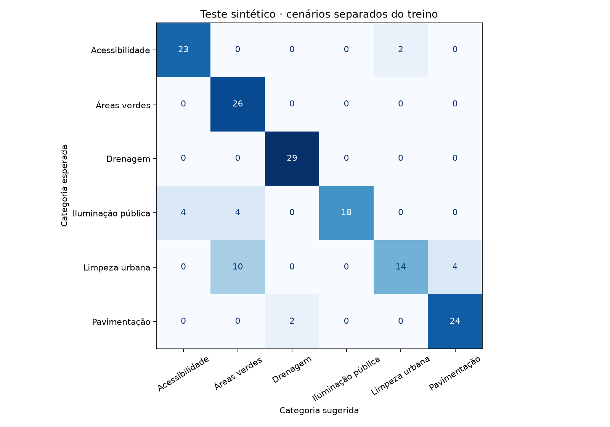

# ZELA · Machine Learning


O ZELA organiza pedidos de zeladoria de uma rua ou bairro. Este componente lê a descrição de um relato, sugere a categoria do problema e mostra quais termos contribuíram para a sugestão. Moradores e trabalhadores registram o problema, e o operador confere a categoria para encaminhar a ocorrência pelo canal municipal.

**Global Solution 2026 · CitizenTech · Engenharia de Software · FIAP**

Guilherme Vital Rodrigues

## Executar

Use Python 3.12 e execute na raiz do repositório.

```sh
python3.12 -m venv .venv
source .venv/bin/activate
python -m pip install -r requirements.txt
python -m pip install -e . --no-deps
zela-ml serve
```

No Windows, crie o ambiente com `py -3.12 -m venv .venv` e ative com `.venv\Scripts\Activate.ps1` no PowerShell. O modelo treinado já está em `artifacts/`.

Abra a [demonstração local](http://127.0.0.1:8000/) e experimente **Poste apagado** e **Outro assunto**. A [documentação interativa](http://127.0.0.1:8000/docs) descreve a API. O servidor da demonstração escuta em loopback.

```sh
zela-ml predict "O poste da esquina não acende e a rua fica escura à noite."
python scripts/check.py
```

## Experimento

As seis categorias são iluminação pública, limpeza urbana, pavimentação, drenagem, acessibilidade e áreas verdes. O dataset contém **810 relatos simulados de 180 cenários**. Cada cenário e suas variações pertencem à mesma partição. O modelo foi escolhido na validação pelo F1 macro e avaliado em 160 relatos de 36 cenários separados.

| Indicador no teste sintético | Resultado |
| --- | ---: |
| F1 macro do modelo | **0,830** |
| F1 macro da referência pela frequência | 0,051 |
| Acurácia | 83,75% |
| Cenários com todas as variações classificadas corretamente | 29 de 36 |
| Intervalo de 95% para F1 macro, com reamostragem por cenário | 0,685 a 0,939 |
| Relatos com pontuação e margem acima dos limites de revisão | 18 de 160 |
| Casos ambíguos ou fora do escopo sinalizados para revisão | 11 de 12 |

O modelo selecionado combina TF-IDF de palavras e caracteres com regressão logística. A política de revisão priorizou precisão na validação. No teste, todos os 18 relatos que passaram pelos limites receberam a categoria correta, mas a cobertura foi baixa. Entre os casos de desafio, o modelo deixou passar um relato que misturava alagamento e galhos quebrados. O operador confere o encaminhamento mesmo quando a sugestão está acima do limite.

Os números descrevem a simulação. A validação com relatos de campo e a estimativa do efeito sobre o tempo de triagem ficam para o piloto.



## Reproduzir e integrar

- [Notebook executado](notebooks/01_classificacao_relatos.ipynb) com análise da base, comparação, matriz, casos de erro e chamada à API. No editor, selecione o Python de `.venv` e execute as células em ordem.
- [Origem e estrutura da base](data/README.md), [métricas em JSON](reports/metrics.json) e [erros do teste](reports/errors.csv).
- `zela-ml dataset` recria o CSV. `zela-ml train` treina o modelo e atualiza os resultados e o manifesto de integridade. Use o artefato do repositório ou do próprio treino.
- `POST /classify` recebe `{"text": "..."}` e devolve a categoria sugerida, três pontuações, termos associados e `requires_review`. `GET /health` verifica se o artefato foi carregado e `GET /model` informa as métricas e categorias. A API faz a classificação em memória.

Para demonstrar uma versão, use o commit revisado com seu respectivo artefato e manifesto. O retorno a uma versão anterior usa o conjunto desses arquivos do commit escolhido. [Fluxo de desenvolvimento](CONTRIBUTING.md) · [Roteiro da apresentação](docs/apresentacao.md).
